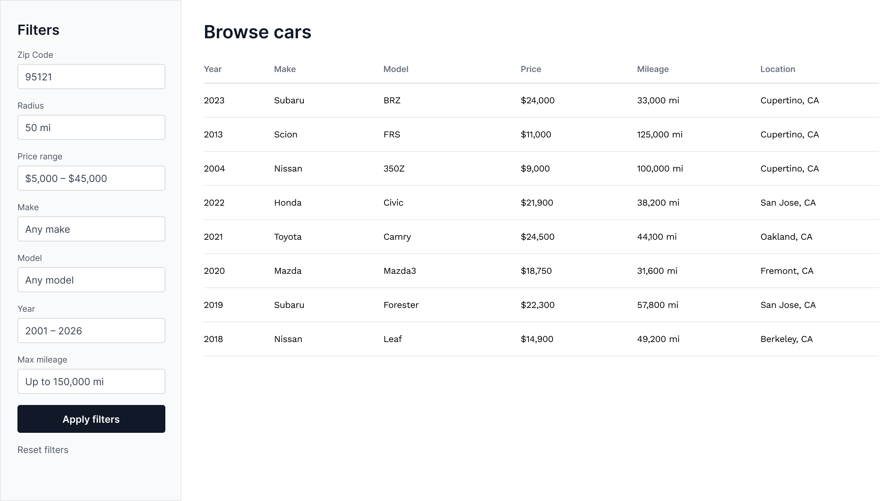
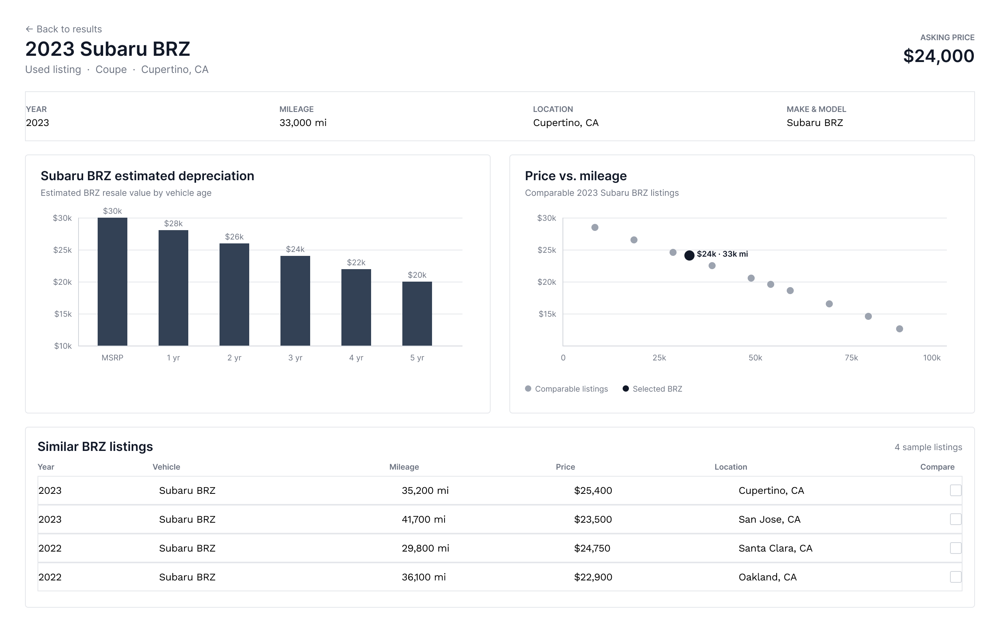

# car-deals

## Authors
* Alicia Shi
* Edwin Yue

## Description
Buying a car can be daunting and require a lot of research beforehand, but Car Deals can help with that. It provides helpful insights for consumers looking to purchase a vehicle. It pulls details of car listings from [Auto.dev API](https://docs.auto.dev/v2), including price, make, model, year and location. 
There will be two main interface windows. The first is a general browsing area to allow users to view and filter for cars. The second will provide analytical information such as value depreciation for certain models or price differences based on mileage.

## Project Outline/Plan
**Interface Plan**
* Main Browsing Page: The first interface will be the browsing area, it will be pretty simple with a few filters and a list of cars that show up.

* Detailed Car View: The second area will show insights on the car. More specifically, it will show two graphs. One that shows value depreciation of this car based on the years, and one that shows value depreciation of this car based on the price. It also has a list of similar cars.

**Data Collection and Storage Plan** - Alicia Shi

* [Auto.dev API](https://docs.auto.dev/v2/products/vehicle-listings) only allows 1000 API calls a month, each with a maximum of 20 cars per call. To work with this, we will only call APIs with multiple cars in it instead of individual cars. This sacrfices details like photos, but increases the use we get out of the API.
* Main Browsing Page: will call GET based on the user inputs, and will parse the output and put it into a JSON format for the frontend.
* Detailed Car View: will call GET based on the current car to get other cars to compare to. For depreciation by years, it will try to find cars that have different years to use as comparsion, otherwise, it will run a calcuation to estimate those years. For depreciation by miles, it does the same as years but for miles. 
* Storage Plan: All GET requests will be parsed and stored temporarily as a JSON. Only to immdiately be sent to the frontend to be consumed. It will not be stored long term.

**Data Analysis and Visualization Plan** - Edwin Yue
